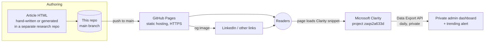

# Infrastructure — Beyond AI blog

Public site: <https://idanshimon.github.io> · Source: this repository (`main`).
This file covers the public parts only. Private operating details (admin dashboard, tokens, scheduled jobs) are kept outside this public repository.

## Diagram



## Components

| Component | Where it runs | Notes |
|---|---|---|
| Pages and assets | GitHub Pages, from `main` root | Static HTML, inline CSS/SVG, `.nojekyll`. Deploys in about 1 minute after push. |
| Article generators | Separate repositories | Some articles (e.g. `decision-models-part-2/`) are built by a script; the template must carry the Clarity snippet. |
| Analytics | Microsoft Clarity, project `zaqs2a633d` | Snippet in every page `<head>`. Scroll, attention and click maps, recordings, referrers. Anonymous, aggregate. |
| Share previews | `og:image` PNG per listed article | 1200×630, rendered from HTML with headless Chrome. |
| Sponsorship | GitHub Sponsors via `.github/FUNDING.yml` | Footer link on articles. |
| Admin dashboard | Private, not in this repo | Daily Clarity export snapshots, trends, trending alert. Planned; see status. |

## Outside services

- **GitHub Pages**: hosting. Free.
- **Microsoft Clarity**: analytics. Free, no traffic cap. Export API limit: 10 calls per project per day, data for the last 1–3 days only.
- **LinkedIn**: distribution. Caches link previews; use Post Inspector after changing an `og:image`.

## Secrets

None in this repository. The Clarity export token is stored privately on the operator's machine and never committed.

## How to check it works

```bash
curl -s -o /dev/null -w "%{http_code}\n" https://idanshimon.github.io/            # 200
grep -rL zaqs2a633d --include=*.html . | grep -v '^./assets/'                       # empty = every page tracked
grep -rn "No tracking\|No analytics" --include=*.html .                              # empty
gh api repos/idanshimon/idanshimon.github.io/pages/builds/latest --jq .status        # built
```

Clarity dashboard shows sessions within about 2 hours of the first visits.

## Cost

$0 (GitHub Pages, Clarity, Sponsors are free).

## Status

- Hosting, previews, sponsorship: live.
- Clarity snippet: added to every page on 2026-11-08 (live after the next push).
- Admin dashboard and trending alert: planned.
